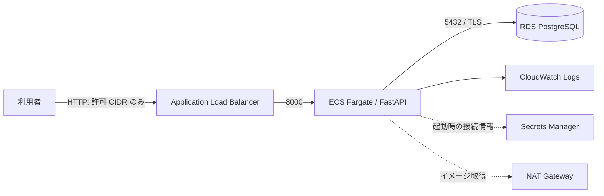

# Yoyaku Cloud — AWS 予約 API 基盤

[English](README.en.md)

日本の店舗向け予約業務を題材にした、AWS インフラとバックエンドの個人学習プロジェクトです。空き枠の確認、予約受付・一覧・キャンセル、時刻の UTC 正規化、同一枠の重複防止を実装しています。実務経験や本番稼働を示すものではありません。

## 構成



Terraform は東京リージョンを既定とし、パブリック・プライベートサブネット、NAT、ALB、ECS、RDS、IAM、ログを定義します。DB とタスクはプライベートサブネットに配置します。DB の一意制約が同時リクエストの重複を防ぎます。予約時刻はタイムゾーン付きで受け取り UTC に変換します。日付別の検索範囲は日本時間で算出します。認証がないため、このサンプルでは誰でも予約一覧を閲覧・削除できます。

## ローカル実行

Python 3.9 以上が必要です。ローカルでは SQLite を使用します。

```bash
python3 -m venv .venv
source .venv/bin/activate
pip install -r requirements-dev.txt
pytest -q
uvicorn app.main:app --reload
```

`http://127.0.0.1:8000/` で日本語デモ画面、`http://127.0.0.1:8000/docs` で API 画面を開けます。日付と拠点を選んで空き枠から予約し、一覧からキャンセルできます。予約枠は日本時間 9〜18 時の 1 時間単位です。API からの直接登録は任意のタイムゾーン付き時刻を受け付けます。

```bash
curl -X POST http://127.0.0.1:8000/reservations \
  -H 'Content-Type: application/json' \
  -d '{"resource":"tokyo-room","customer":"山田","starts_at":"2027-01-01T10:00:00+09:00"}'
```

同じ resource と時刻を再登録すると 409。返却された ID を使って `GET /reservations/{id}` で確認できます。

## AWS デプロイ（学習用）

**ALB、NAT Gateway、Fargate、RDS などは稼働中に料金が発生します。** 本構成は認証なし・HTTP のデモで、許可 CIDR を自分の IP に限定し、個人情報を入力しないでください。TLS、認証、複数 AZ の障害対策、バックアップ方針は本番利用前に別途必要です。

1. AWS CLI、Docker、Terraform を用意し、東京リージョンで利用可能な AWS 資格情報を設定します。
2. ECR リポジトリを別途作成し、ECR にログインした上で Docker イメージをビルド・プッシュします。ECS の既定は x86-64 のため、Apple Silicon では `docker build --platform linux/amd64 -t IMAGE_URI .` を使います。URI はイミュータブルなタグを推奨します。
3. `infra` で以下を実行します。パスワードは環境変数などで安全に渡します。

```bash
export TF_VAR_image_uri='ACCOUNT.dkr.ecr.ap-northeast-1.amazonaws.com/REPOSITORY:TAG'
export TF_VAR_allowed_cidr='YOUR_PUBLIC_IP/32'
read -s TF_VAR_db_password; export TF_VAR_db_password
terraform -chdir=infra init
terraform -chdir=infra plan
terraform -chdir=infra apply
terraform -chdir=infra output url
```

終了後は同じ変数と state を使って `terraform -chdir=infra destroy` を実行し、ECR イメージ、ログ、Secrets Manager の削除予定状態も確認してください。RDS は最終スナップショットを作成せず削除されます。

**State には DB パスワードと接続文字列が含まれます。** state を Git に追加せず、安全な暗号化・アクセス制御付きの保存先を使ってください。Secrets Manager に格納される値は ECS の起動時に読み込まれます。単一 NAT・単一 DB・単一タスクはコストを抑えたデモ構成であり、高可用性構成ではありません。

## 検証状況

CI は Python テスト、Docker ビルド、Terraform validate を実行する設定です。AWS への実デプロイや負荷試験は本リポジトリだけでは保証しません。結果を記録する際は、実際に実行した範囲のみ記載してください。運用時の確認項目は [運用メモ](docs/runbook.md) を参照。

実際に行った検証と未検証の項目は [検証記録](docs/verification.md) に記載しています。
